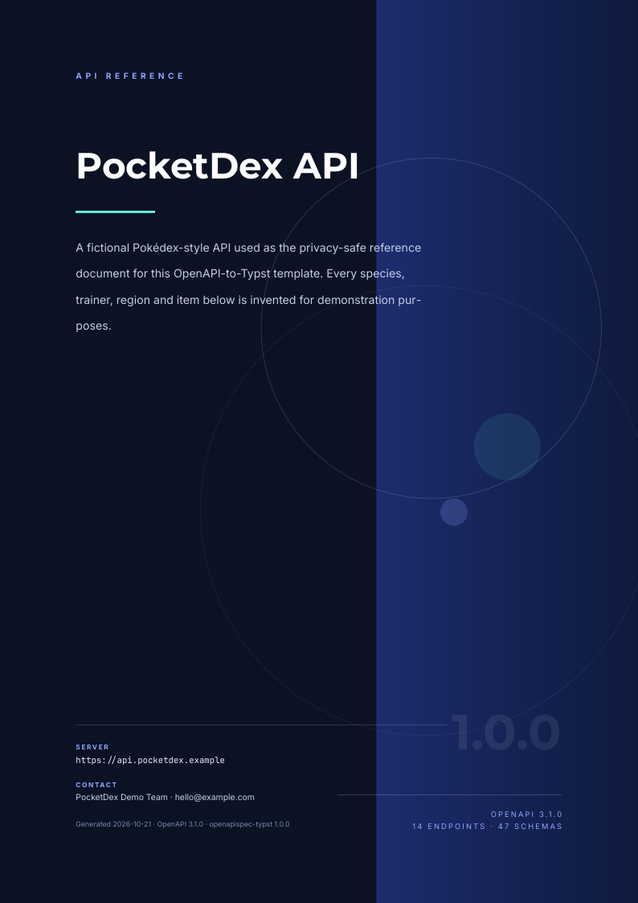
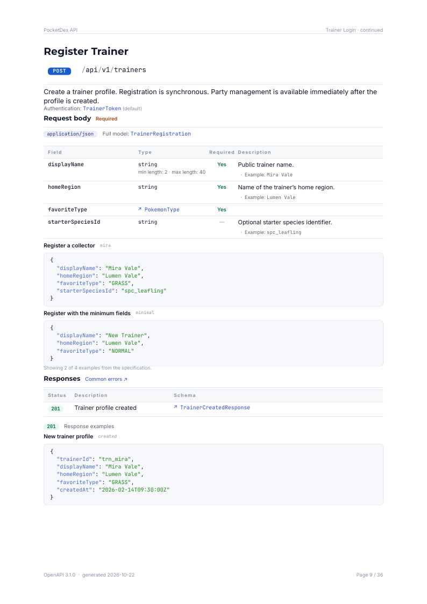
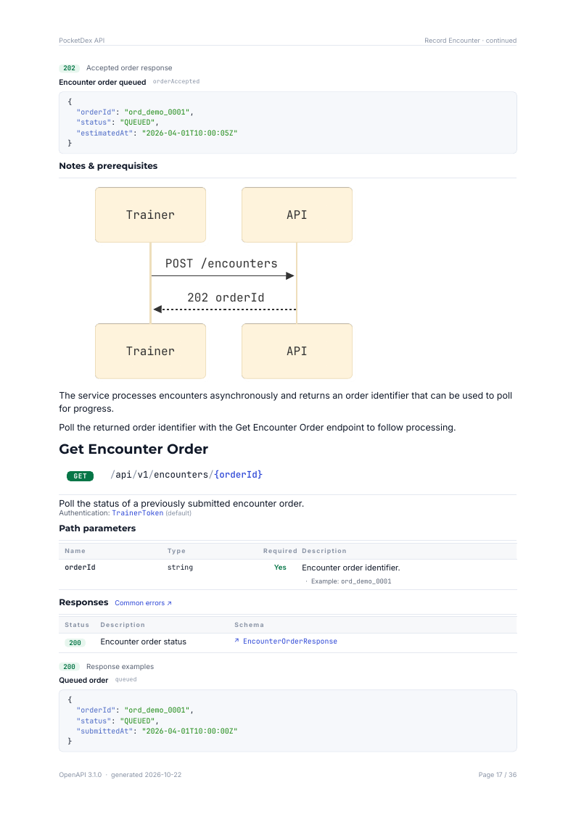
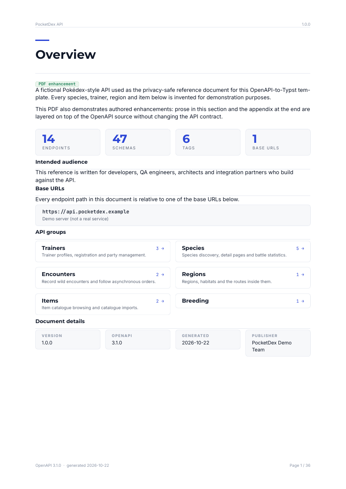

# openapispec-typst

Turn OpenAPI **3.0/3.1** documents into polished, navigable PDFs with
[Typst](https://typst.app).

This repository is a **privacy-safe reference project** for the converter. The
bundled specification is a fictional **PocketDex API** — no production,
customer or third-party API data is included.

[PDF](dist/pocketdex.pdf) · [live demo](https://console.maomaothinks.com/test-pdf/) · [landing page](dist/index.html) · [spec](specs/pocketdex.yaml)

<a href="docs/preview-cover.png"></a>
<a href="docs/preview-endpoint.png"></a>

<a href="docs/preview-mermaid.png"></a>

## Features

- Designed cover, clickable table of contents, PDF outline/bookmarks, running
  headers and page footers.
- Structured front matter: overview, base URLs, authentication, request
  conventions, response/error conventions, and an endpoint summary.
- Endpoints grouped by tag, with method badges, wrapped paths, deprecated
  markers, and a consistent section order.
- **Local request comprehension:** request bodies show top-level fields inline;
  oneOf request modes become a variant table with required fields; the full
  model is linked from the endpoint.
- Representative request/response examples with JSON syntax highlighting,
  human-readable titles and explicit example counts.
- Deduplicated authentication, error and success-envelope documentation, with
  a small "Common errors" link per endpoint.
- **Classified Data Models:** primary models, versioned models rendered as
  diffs against their base version, compact response envelopes, small reusable
  models and helper models.
- **Mermaid diagrams in Markdown:** fenced `mermaid` code blocks in descriptions
  are rendered as SVG through [`@preview/merman:0.5.0`](https://typst.app/universe/package/merman/);
  other code fences stay as code.
- **GFM tables in Markdown:** pipe tables in descriptions render in the
  document's own table design (hairline row strokes, tapered columns, bold
  small header), and small tables move to the next page whole.
- Example payloads are pretty-printed and capped at 46 lines with an explicit
  truncation marker, so a rendered example always fits one page; the full
  payload stays in the source document.
- Enumerations index and Specification Notes for source observations.
- Three document densities: `concise`, `reference` (default) and `exhaustive`.
- TypeScript pipeline, npm scripts, atomic build output and fixture tests.

## Quick start

```bash
npm install
npm run build
npm run serve      # http://localhost:8000
npm run check
npm run typecheck
```

`npm install` runs a postinstall step that aligns the typed `typst` npm API
(which currently bundles an older Typst) with the official 0.15.1 CLI
distributed by `@flukxr/typst-cli`. The build still calls the typed API:

```ts
import * as typst from "typst";
await typst.compile("templates/main.typ", "dist/pocketdex.pdf", { root: "." });
```

## Document modes

```bash
npm run build -- --mode concise
MODE=exhaustive npm run build
make build MODE=concise
```

| Mode | Behaviour |
| --- | --- |
| `concise` | one representative example per operation, compact models |
| `reference` | balanced examples, classified models, inline request fields |
| `exhaustive` | all examples and full model tables |

## PDF enhancements

The OpenAPI file remains the only source of API contract. A Typst enhancement
module can replace or extend prose at specific documentation slots without
changing paths, methods, schemas, examples or auth.

Modules live in `overrides/` by default. Every module declares its format
version, applicable spec IDs and optional priority:

```typst
#let meta = (
  version: 1,
  specs: ("pocketdex", "pocketdex-v2"),
  priority: 0,
)

#let overrides = (
  overview: (
    description: (append: [ ... ]),
  ),
  tags: (
    "Trainers": (
      description: (append: [ ... ]),
    ),
  ),
  operations: (
    recordEncounter: (
      purpose: [ ... ],           // replace
      notes: (append: [ ... ]),  // keep the source, then add
      requestBody: (prepend: [ ... ]),
      parameters: (
        query: (
          pageNo: (append: [ ... ]),
        ),
      ),
    ),
  ),
  schemas: (
    SpeciesDetail: (
      description: (append: [ ... ]),
      fields: (
        habitat: (append: [ ... ]),
      ),
    ),
  ),
)
```

Slots:

| Target | Allowed slots |
| --- | --- |
| `overview` | `description` |
| `tags.<name>` | `description` |
| `operations.<operationId>` | `purpose`, `notes`, `requestBody`, `parameters.<location>.<name>` |
| `schemas.<name>` | `description`, `fields.<property>` |

A plain Typst content block replaces the source prose. A dictionary with
`prepend` and/or `append` adds content while keeping the source. Empty
replacement (`[]`) removes the prose and suppresses the empty surrounding block.

### Applicability, priority and validation

- Spec identity comes from root-level `x-spec-id`, or `--spec-id`/`SPEC_ID`.
- `specs` is required and exact. If overrides exist and no identity resolves, the
  build fails.
- All targets must exist in every listed spec.
- Higher module priority wins conflicts; equal highest priority fails.
- All applicable modules are validated, including shadowed ones.
- Discovery: recursive `overrides/**/*.typ`; files beginning with `_` are helpers.
- `--overrides <file|dir>` replaces default discovery and must stay inside the
  project root.
- Errors are aggregated with module path, target path, slot and conflict details.

### Showing or hiding markers

By default the PDF shows a **PDF enhancement** chip on affected sections and a
final **PDF Enhancements** appendix listing module, priority and target.

```bash
npm run build -- --hide-enhancements
HIDE_ENHANCEMENTS=1 npm run build
```

The content is still applied and validated; only the chips and appendix are
hidden.

<a href="docs/preview-enhancement.png"></a>

`overrides/pocketdex.typ` is a working sample. Add Markdown fences for Mermaid
diagrams as usual; arbitrary Typst content is allowed, but field and parameter
slots render inside table cells, so keep those inline.

## Use another spec

```bash
SPEC=specs/my-api.yaml NAME=my-api SPEC_ID=my-api npm run build
```

The build writes `dist/my-api.pdf` and a landing page pointing at it. The
converter accepts local OpenAPI 3.0/3.1 YAML/JSON and resolves local `$ref`s
only; external references are rejected with a clear error.

## Architecture

```
spec YAML/JSON
      |
      v
src/spec.ts       load + validate 3.0/3.1 + resolve $refs
src/model.ts      normalise, deduplicate, classify, apply mode
src/typst.ts      encode build/generated/data.typ
src/build.ts      typst.compile() -> atomic dist/ publish
```

| Path | Purpose |
| --- | --- |
| `specs/pocketdex.yaml` | Fictional PocketDex OpenAPI 3.1 demo |
| `src/spec.ts` | YAML loader, `$ref` resolver, validation |
| `src/model.ts` | Normalisation, classification, deduplication |
| `src/typst.ts` | Typst literal encoder |
| `src/cli.ts` | Converter CLI |
| `src/build.ts` | PDF build and atomic publish |
| `src/enhancements.ts` | Enhancement discovery and generated Typst bundle |
| `overrides/` | Typst prose enhancements (one or more self-declaring modules) |
| `templates/lib.typ` | Layout, theme and PDF components |
| `templates/main.typ` | Document entry point |
| `templates/index.html` | Landing page template |
| `tests/*.test.ts` | Node test suite and fixtures |
| `dist/` | Generated PDF and landing page |

## Customising

All visual design lives in `templates/lib.typ`: palette, fonts, method and
status colours, page margins, cover composition, tables and schema cards. The
converter only writes data, so you can restyle without touching TypeScript.

`npm run fmt` runs `typstyle`; `make watch` recompiles on save (run
`npm run build` once first).

## Tests

```bash
npm run check
```

The suite covers model invariants, mode density, CLI failures, fixture
compilation and the rendered PDF.

## Hosted demo

The current PocketDex reference is served at
<https://console.maomaothinks.com/test-pdf/>; the direct PDF URL is
<https://console.maomaothinks.com/test-pdf/pocketdex.pdf>.

## Notes

- All characters, species, trainers, regions and items are fictional.
- `build/` and `node_modules/` are ignored; `dist/` is committed so the
  generated PDF can be downloaded directly from the repository.
- `@preview/cmarker:0.1.6` and `@preview/merman:0.5.0` are fetched on the first
  compile and cached by Typst in `~/.cache/typst/packages/`. Merman requires
  Typst 0.15+, which the project already uses.
- `npm run check` compiles a fixture containing a Mermaid fence, so diagram
  support is covered by the test suite.
- Static Inter, Montserrat and JetBrains Mono TTFs live in `fonts/` (with their
  SIL Open Font License files); when present, the build passes them via
  `--font-path` so the PDFs embed exactly these faces.
- Long identifiers get zero-width break opportunities after separators and
  camelCase humps, and long unbroken runs inside JSON every 70 characters
  (30 for inline `Example:` snippets), so nothing overflows its column.

## Typst 0.15.1 layout workarounds

Typst 0.15.1 (the newest release) has a region-exhaustion bug
([typst/typst#8790](https://github.com/typst/typst/issues/8790)): when a
child cannot fit the remaining page region, later children are stacked at or
past the region boundary instead of advancing — long tables pile rows on top
of each other and long examples overlap the footer. The template works around
it structurally:

- Property tables render as unbreakable 10-row chunks (`schema-props-table`),
  so a row never needs to move mid-table.
- Cards, request bodies and success-envelope groups are only unbreakable when
  they are provably small; anything that can be taller than the remaining
  page stays breakable.
- Example payloads are capped by the converter (46 lines, explicit truncation
  marker) so an example block always fits one page and moves whole.
- Markdown tables with up to 9 rows are wrapped unbreakable for the same
  reason.

When a fixed Typst release ships, these guards can be simplified.
